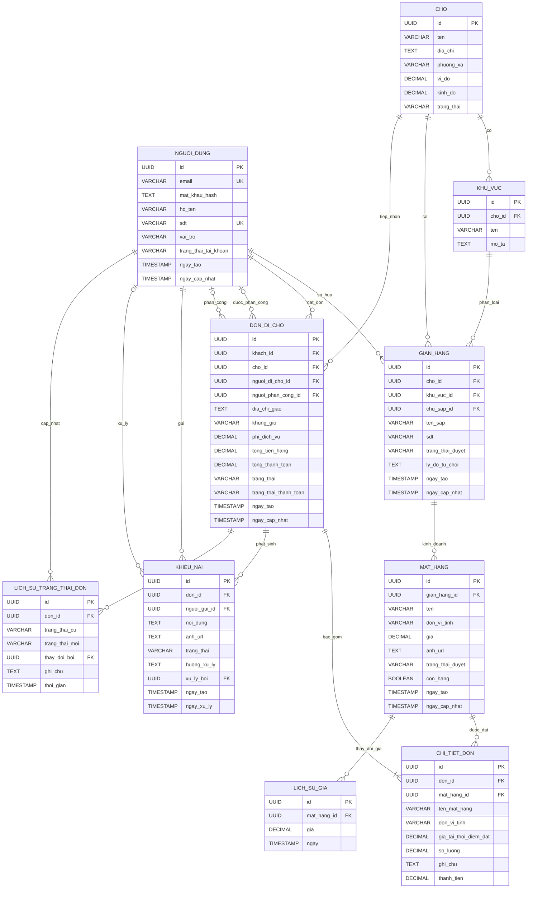

# ERD – Nền tảng số hóa chợ truyền thống – Đi chợ hộ

## 1. Tổng quan

Cơ sở dữ liệu sử dụng PostgreSQL trên Supabase.

Hệ thống có 4 vai trò:
- KHACH: Khách hàng.
- TIEU_THUONG: Tiểu thương.
- NGUOI_DI_CHO: Người đi chợ hộ.
- BQL: Ban quản lý chợ.

Mỗi tài khoản chỉ có một vai trò duy nhất, được lựa chọn khi đăng ký.
Không hỗ trợ bổ sung hoặc chuyển đổi vai trò.

Quy trình xét duyệt:
- KHACH: Không cần xét duyệt.
- NGUOI_DI_CHO: Không cần xét duyệt.
- TIEU_THUONG: Được đăng ký tài khoản nhưng phải đăng ký gian hàng và chờ BQL xét duyệt trước khi kinh doanh.
- BQL: Tài khoản được cấp nội bộ, không đăng ký công khai.

## 2. Sơ đồ ERD

## 3. Quy định giá trị và trạng thái

### 3.1. Vai trò người dùng

Cột `nguoi_dung.vai_tro`:
- KHACH
- TIEU_THUONG
- NGUOI_DI_CHO
- BQL

Mỗi tài khoản chỉ có một vai trò.

### 3.2. Trạng thái gian hàng

Cột `gian_hang.trang_thai_duyet`:
- CHO_DUYET: Gian hàng đang chờ BQL xét duyệt.
- DA_DUYET: Gian hàng đã được duyệt và có thể hoạt động.
- TU_CHOI: Gian hàng bị từ chối.
- KHOA: Gian hàng bị khóa bởi BQL.

### 3.3. Trạng thái mặt hàng

Cột `mat_hang.trang_thai_duyet`:
- CHO_DUYET
- DA_DUYET
- TU_CHOI
- KHOA

Cột `mat_hang.con_hang` xác định mặt hàng còn hàng hay hết hàng.

### 3.4. Trạng thái đơn hàng

Cột `don_di_cho.trang_thai`:
- CHO_NGUOI_DI_CHO
- DANG_DI_CHO
- DANG_GIAO
- DA_GIAO
- DA_HUY

Cột `don_di_cho.trang_thai_thanh_toan` được quản lý độc lập:
- CHUA_THANH_TOAN
- DA_THANH_TOAN
- THAT_BAI
- HOAN_TIEN

### 3.5. Trạng thái khiếu nại

Cột `khieu_nai.trang_thai`:
- MOI
- DANG_XU_LY
- DA_GIAI_QUYET
- TU_CHOI

## 4. Quy tắc nghiệp vụ và ràng buộc dữ liệu

1. Một người dùng có thể sở hữu nhiều gian hàng.
2. Một gian hàng thuộc một chợ và một khu vực của chợ đó.
3. Một gian hàng có thể kinh doanh nhiều mặt hàng.
4. Một đơn đi chợ thuộc về một khách hàng và một chợ.
5. Một đơn hàng có thể chứa nhiều mặt hàng từ nhiều gian hàng khác nhau, nhưng tất cả phải thuộc cùng một chợ.
6. Mỗi dòng hàng có ghi chú riêng dành cho người đi chợ.
7. Thông tin tên mặt hàng, đơn vị tính và giá tại thời điểm đặt phải được lưu lại trong chi tiết đơn để bảo toàn lịch sử giao dịch.
8. Chỉ mặt hàng đã được duyệt, còn hàng và thuộc gian hàng đã được duyệt mới được đặt.
9. BQL là bên duy nhất được phân công người đi chợ hộ cho đơn hàng.
10. Người đi chợ hộ chỉ được xử lý những đơn được phân công cho mình.
11. BQL có quyền khóa hoặc mở lại gian hàng.
12. Khi gian hàng bị khóa, các mặt hàng thuộc gian hàng đó không được tiếp tục đặt.
13. Tổng tiền hàng và tổng thanh toán phải do Backend tính toán, không lấy giá trị tổng tiền do Client gửi lên làm căn cứ.
14. Khi trạng thái đơn hàng thay đổi, hệ thống phải lưu lịch sử thay đổi trong cùng một giao dịch dữ liệu.
15. Không xóa cứng dữ liệu đơn hàng, chi tiết đơn hàng và lịch sử giao dịch.

## 5. Ràng buộc cần xử lý ở Backend

- Kiểm tra khu vực và gian hàng phải thuộc cùng một chợ.
- Kiểm tra tất cả mặt hàng trong một đơn phải thuộc cùng chợ với đơn hàng.
- Kiểm tra trạng thái duyệt và tình trạng còn hàng tại thời điểm đặt đơn.
- Kiểm tra người đi chợ hộ được phân công đúng đơn trước khi cập nhật trạng thái.
- Kiểm tra người gửi khiếu nại phải là khách hàng sở hữu đơn hàng.
- Chỉ BQL được xử lý khiếu nại và phân công người đi chợ hộ.
- Việc cập nhật trạng thái đơn và thêm lịch sử trạng thái phải được thực hiện trong cùng một transaction.

## 6. Ghi chú thiết kế

- `nguoi_dung.vai_tro` lưu vai trò duy nhất của tài khoản, không cần bảng vai trò riêng.
- Không sử dụng bảng đăng ký bổ sung vai trò.
- Không sử dụng bảng đăng ký người đi chợ hộ vì vai trò này không cần BQL xét duyệt.
- Việc xét duyệt tiểu thương được thực hiện thông qua `gian_hang.trang_thai_duyet`.
- `lich_su_trang_thai_don` là bảng bổ sung để theo dõi toàn bộ quá trình xử lý đơn hàng.
- `lich_su_gia` lưu lại giá theo thời gian để phục vụ việc xem biến động giá mặt hàng.
- Các khóa ngoại, CHECK, UNIQUE và quy tắc transaction sẽ được triển khai cụ thể trong PostgreSQL và Backend.
