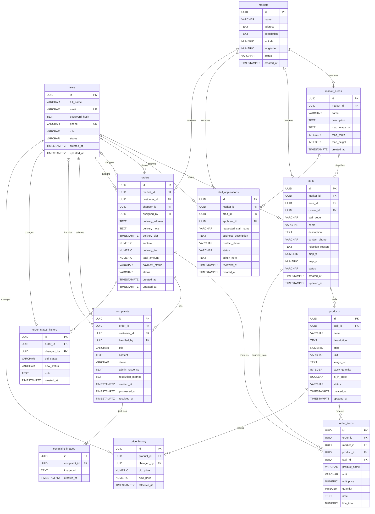

# ERD – Nền tảng số hóa chợ truyền thống – Đi chợ hộ

## 1. Tổng quan

Cơ sở dữ liệu PostgreSQL trên Supabase. ERD dưới đây dùng đúng tên bảng, cột và giá trị trạng thái đang được định nghĩa trong `database/schema.sql`.

### Vai trò người dùng

- `customer`: Khách hàng.
- `stall_owner`: Tiểu thương.
- `shopper`: Người đi chợ hộ.
- `admin`: Ban quản lý chợ.

Mỗi tài khoản có một vai trò trong cột `users.role`. Không tự chuyển vai trò trong quy trình đăng ký.

## 2. Sơ đồ ERD

## 3. Giá trị vai trò và trạng thái

### 3.1. `users.role`
- `customer`
- `shopper`
- `stall_owner`
- `admin`

### 3.2. `users.status`
- `active`
- `locked`

### 3.3. `markets.status`
- `active`
- `inactive`

### 3.4. `stalls.status`
- `pending`
- `approved`
- `locked`
- `rejected`

### 3.5. `products.status` và `products.is_in_stock`
- `status`: `pending`, `approved`, `hidden`, `rejected`.
- `is_in_stock`: cờ còn hàng; `stock_quantity` lưu số lượng tồn kho.

### 3.6. `orders.status`
- `pending`
- `confirmed`
- `preparing`
- `ready`
- `delivering`
- `completed`
- `cancelled`

### 3.7. `orders.payment_status`
- `pending`
- `paid`
- `failed`
- `refunded`

### 3.8. `complaints.status`
- `pending`
- `processing`
- `resolved`
- `rejected`

## 4. Quy tắc nghiệp vụ và ràng buộc

1. Một người dùng có thể sở hữu nhiều gian hàng.
2. Một gian hàng thuộc một chợ và một khu vực của chính chợ đó.
3. Một gian hàng kinh doanh nhiều sản phẩm.
4. Một đơn hàng thuộc một khách hàng và một chợ.
5. Một đơn hàng có thể lấy hàng từ nhiều gian hàng, nhưng mọi dòng hàng phải mang cùng `market_id` với đơn hàng. Khóa ngoại ghép `order_items(order_id, market_id)` tham chiếu `orders(id, market_id)`; trigger PostgreSQL kiểm tra sạp của sản phẩm có cùng `market_id` với đơn hàng, vì vậy database cũng chặn dòng hàng khác chợ. Backend vẫn cần kiểm tra trạng thái sạp/sản phẩm và tồn kho.
6. Chi tiết đơn lưu tên sản phẩm, đơn vị tính, đơn giá tại thời điểm mua, số lượng và ghi chú.
7. Chỉ sản phẩm đã duyệt, còn hàng và thuộc sạp đã duyệt mới được đặt. Backend kiểm tra `status`, `is_in_stock`, `stock_quantity` và trạng thái sạp.
8. BQL là bên phân công người đi chợ hộ; `orders.assigned_by` lưu tài khoản thực hiện phân công.
9. Người đi chợ hộ chỉ xử lý đơn được phân công cho mình (kiểm tra tại Backend).
10. Khiếu nại có thể có nhiều ảnh; ảnh lưu trong `complaint_images`.
11. BQL xử lý khiếu nại; `handled_by`, `resolution_method` và `processed_at` lưu thông tin xử lý.
12. Thay đổi giá sản phẩm được ghi vào `price_history`, gồm giá cũ, giá mới, người thay đổi và thời điểm có hiệu lực.
13. Tổng tiền do Backend tính toán, không tin tổng tiền Client gửi lên.
14. Khi đổi trạng thái đơn, cập nhật đơn và ghi `order_status_history` trong cùng transaction.
15. Không xóa cứng dữ liệu đơn hàng, chi tiết đơn và lịch sử giao dịch.

## 5. Lưu ý triển khai

- ERD dùng đúng tên tiếng Anh và giá trị role/status trong SQL và backend, tránh song song hai bộ enum tiếng Việt/tiếng Anh.
- `stall_applications` và `complaint_images` là bảng thực tế trong SQL nên phải xuất hiện trong ERD.
- `order_items.market_id` được bổ sung và khóa ngoại ghép gắn dòng hàng với chợ của đơn; trigger `check_order_item_market()` kiểm tra sản phẩm/sạp cũng thuộc chợ đó. Backend cần truyền market_id của đơn khi insert từng dòng.
- Cột mới `is_in_stock` bổ sung cho cờ còn hàng; `stock_quantity` vẫn giữ để theo dõi tồn kho.
- Khi thêm các cột mới vào database đã tồn tại, dùng migration riêng thay vì chạy lại schema tạo bảng từ đầu.
