# USE CASE – HỆ THỐNG ĐI CHỢ HỘ

## 1. Tổng quan

Hệ thống Đi chợ hộ hỗ trợ số hóa hoạt động tại chợ truyền thống, kết nối khách hàng, tiểu thương, người đi chợ hộ và Ban quản lý chợ.

## 2. Quy định về tài khoản và vai trò

- Mỗi tài khoản chỉ có một vai trò duy nhất.
- Người dùng chọn vai trò ngay khi đăng ký tài khoản.
- Không hỗ trợ thêm hoặc chuyển đổi vai trò sau khi đăng ký.
- Các vai trò được đăng ký công khai:
  - `KHACH`: Khách hàng.
  - `TIEU_THUONG`: Tiểu thương.
  - `NGUOI_DI_CHO`: Người đi chợ hộ.
- `BQL`: Ban quản lý chợ, tài khoản được cấp nội bộ, không đăng ký công khai.
- Khách hàng và người đi chợ hộ được sử dụng tài khoản sau khi đăng ký.
- Tiểu thương được đăng ký tài khoản và đăng nhập, nhưng phải đăng ký gian hàng và chờ Ban quản lý chợ xét duyệt trước khi kinh doanh.
- Ban quản lý xét duyệt gian hàng, không xét duyệt vai trò tài khoản tiểu thương.

## 3. Sơ đồ Use Case tổng quát

```mermaid
flowchart LR
    Guest["Khách vãng lai"]
    Customer["Khách hàng"]
    Merchant["Tiểu thương"]
    Shopper["Người đi chợ hộ"]
    Manager["Ban quản lý chợ"]

    subgraph System["HỆ THỐNG ĐI CHỢ HỘ"]

        subgraph Account["Tài khoản và xác thực"]
            UC_Register(["Đăng ký tài khoản"])
            UC_SelectRole(["Chọn một vai trò khi đăng ký"])
            UC_Login(["Đăng nhập"])
            UC_Logout(["Đăng xuất"])
            UC_Profile(["Quản lý thông tin cá nhân"])
        end

        subgraph CustomerFeatures["Chức năng khách hàng"]
            UC_NearMarket(["Chọn chợ gần nhất"])
            UC_ViewStalls(["Xem khu vực và gian hàng"])
            UC_Search(["Tìm kiếm mặt hàng"])
            UC_ViewPrice(["Xem giá và đơn vị tính"])
            UC_Cart(["Quản lý giỏ hàng"])
            UC_Order(["Đặt đơn đi chợ"])
            UC_Time(["Chọn khung giờ giao hàng"])
            UC_Fee(["Xem phí dịch vụ"])
            UC_Track(["Theo dõi trạng thái đơn"])
            UC_Complaint(["Gửi khiếu nại kèm hình ảnh"])
        end

        subgraph MerchantFeatures["Chức năng tiểu thương"]
            UC_RegisterStall(["Đăng ký mở gian hàng"])
            UC_StallStatus(["Theo dõi kết quả xét duyệt gian hàng"])
            UC_ManageStall(["Quản lý thông tin gian hàng"])
            UC_SubmitProduct(["Gửi mặt hàng để xét duyệt"])
            UC_ManageProduct(["Quản lý mặt hàng"])
        end

        subgraph ShopperFeatures["Chức năng người đi chợ hộ"]
            UC_AssignedOrder(["Xem đơn được phân công"])
            UC_Shopping(["Thực hiện đi chợ"])
            UC_Delivery(["Thực hiện giao hàng"])
            UC_UpdateStatus(["Cập nhật trạng thái đơn"])
        end

        subgraph ManagerFeatures["Chức năng Ban quản lý"]
            UC_ManageAccounts(["Quản lý tài khoản BQL"])
            UC_ApproveStall(["Duyệt gian hàng"])
            UC_RejectStall(["Từ chối gian hàng và ghi lý do"])
            UC_ManageArea(["Quản lý khu vực và sơ đồ chợ"])
            UC_ManageMerchant(["Quản lý tiểu thương"])
            UC_LockStall(["Khóa hoặc mở khóa gian hàng"])
            UC_ApproveProduct(["Xét duyệt mặt hàng"])
            UC_MonitorOrder(["Theo dõi đơn hàng"])
            UC_AssignShopper(["Phân công người đi chợ hộ"])
            UC_HandleComplaint(["Tiếp nhận và xử lý khiếu nại"])
            UC_Report(["Xem báo cáo thống kê"])
        end
    end

    Guest --> UC_Register
    Guest --> UC_Login
    UC_Register -->|include| UC_SelectRole

    Customer --> UC_Login
    Customer --> UC_Logout
    Customer --> UC_Profile
    Customer --> UC_NearMarket
    Customer --> UC_ViewStalls
    Customer --> UC_Search
    Customer --> UC_ViewPrice
    Customer --> UC_Cart
    Customer --> UC_Order
    Customer --> UC_Track
    Customer --> UC_Complaint

    UC_Order -->|include| UC_Time
    UC_Order -->|include| UC_Fee

    Merchant --> UC_Login
    Merchant --> UC_Logout
    Merchant --> UC_Profile
    Merchant --> UC_RegisterStall
    Merchant --> UC_StallStatus
    Merchant --> UC_ManageStall
    Merchant --> UC_SubmitProduct
    Merchant --> UC_ManageProduct

    Shopper --> UC_Login
    Shopper --> UC_Logout
    Shopper --> UC_Profile
    Shopper --> UC_AssignedOrder
    Shopper --> UC_Shopping
    Shopper --> UC_Delivery
    Shopper --> UC_UpdateStatus

    UC_Shopping -->|include| UC_UpdateStatus
    UC_Delivery -->|include| UC_UpdateStatus

    Manager --> UC_Login
    Manager --> UC_Logout
    Manager --> UC_ManageAccounts
    Manager --> UC_ApproveStall
    Manager --> UC_RejectStall
    Manager --> UC_ManageArea
    Manager --> UC_ManageMerchant
    Manager --> UC_LockStall
    Manager --> UC_ApproveProduct
    Manager --> UC_MonitorOrder
    Manager --> UC_AssignShopper
    Manager --> UC_HandleComplaint
    Manager --> UC_Report

    UC_ManageMerchant -->|include| UC_LockStall

    Policy1["Mỗi tài khoản chỉ có một vai trò. Không hỗ trợ thêm hoặc chuyển đổi vai trò. BQL được cấp tài khoản nội bộ."]
    Policy2["Tiểu thương chỉ được kinh doanh khi gian hàng đã được BQL phê duyệt."]
    Policy3["Chỉ BQL được phân công người đi chợ hộ. Người đi chợ hộ không tự nhận đơn."]

    UC_SelectRole -.-> Policy1
    UC_RegisterStall -.-> Policy2
    UC_AssignShopper -.-> Policy3
```



## 4. Mô tả các nhóm chức năng

### 4.1. Khách vãng lai
- Đăng ký tài khoản.
- Chọn một vai trò khi đăng ký.
- Đăng nhập.

### 4.2. Khách hàng
- Chọn chợ gần nhất dựa trên vị trí.
- Xem các khu vực và gian hàng trong chợ.
- Tìm kiếm mặt hàng theo tên.
- Xem giá bán và đơn vị tính.
- Thêm mặt hàng từ nhiều gian hàng trong cùng một chợ vào giỏ hàng.
- Đặt đơn đi chợ và nhập ghi chú riêng cho từng mặt hàng.
- Chọn khung giờ giao hàng.
- Xem phí dịch vụ trước khi xác nhận đặt đơn.
- Theo dõi trạng thái đơn hàng.
- Gửi khiếu nại kèm hình ảnh.

### 4.3. Tiểu thương
- Đăng ký mở gian hàng tại chợ.
- Theo dõi kết quả xét duyệt gian hàng.
- Quản lý thông tin gian hàng.
- Gửi mặt hàng để Ban quản lý xét duyệt.
- Quản lý thông tin và tình trạng mặt hàng.

### 4.4. Người đi chợ hộ
- Xem các đơn hàng được Ban quản lý phân công.
- Thực hiện mua hàng tại chợ.
- Thực hiện giao hàng cho khách.
- Cập nhật trạng thái đơn hàng trong quá trình thực hiện.

### 4.5. Ban quản lý chợ
- Quản lý tài khoản Ban quản lý.
- Xét duyệt hoặc từ chối đăng ký gian hàng và ghi lý do.
- Quản lý khu vực và sơ đồ chợ.
- Quản lý tiểu thương.
- Khóa hoặc mở khóa gian hàng.
- Xét duyệt mặt hàng, kiểm soát mặt hàng không được phép kinh doanh.
- Theo dõi đơn hàng.
- Phân công người đi chợ hộ.
- Tiếp nhận và xử lý khiếu nại.
- Xem báo cáo thống kê: số gian hàng đang hoạt động, doanh thu theo khu vực và tỷ lệ hủy đơn.

## 5. Quy tắc nghiệp vụ quan trọng

1. Một đơn hàng chỉ thuộc một chợ nhưng có thể chứa mặt hàng từ nhiều gian hàng trong cùng chợ.
2. Mỗi tiểu thương có thể sở hữu nhiều gian hàng.
3. Mỗi gian hàng phải được Ban quản lý xét duyệt riêng.
4. Gian hàng chưa được duyệt hoặc đang bị khóa không được kinh doanh.
5. Mặt hàng phải được duyệt và còn hàng mới được phép đặt mua.
6. Khi khách hàng xác nhận đặt đơn, hệ thống phải kiểm tra lại trạng thái gian hàng và mặt hàng.
7. Chỉ Ban quản lý được phân công người đi chợ hộ cho đơn hàng.
8. Trạng thái đơn hàng và trạng thái thanh toán được quản lý riêng.
9. Trạng thái đơn hàng chính: `CHO_NGUOI_DI_CHO` → `DANG_DI_CHO` → `DANG_GIAO` → `DA_GIAO`. Ngoài ra có trạng thái `DA_HUY` khi đơn bị hủy.
10. Tổng tiền hàng và phí dịch vụ được hệ thống tính toán, không nhận giá trị tổng tiền do ứng dụng khách hàng tự quyết định.
```

## 4. Cách đưa lên GitHub
